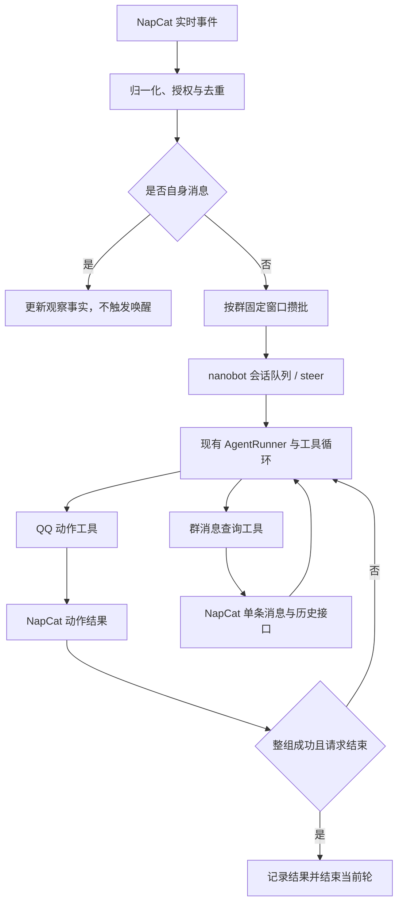

# NapCat 群聊攒批与工具导向自主回复

本文记录已确认的实现设计，作为开发和验收依据。配置形状、工具名称和内部类型属于拟定接口，实施时需要加入对应的 schema、注册和运行时接线。

## 1. 目标与范围

为 NapCat 的指定 QQ 群提供持续观察、固定窗口攒批和自主参与能力。模型根据观察到的群消息决定发送、引用回复、表情回应、戳一戳或保持沉默。所有面向群的可见回应通过动作工具执行。

复用 nanobot 的 Python gateway、AgentLoop、AgentRunner、会话队列、steer、工具加载、工作区权限和现有恢复机制。群观察和平台动作由 NapCat 渠道侧承接，执行与策略继续归 gateway。WebUI 和 TUI 只负责配置和展示。

自主模式只在明确启用且通过 `allowGroups` 授权的 NapCat 群生效。其他获准群按 `groupPolicy` 处理；私聊使用 `allowFrom` 和已有配对授权。每个自主群使用独立会话，避免被 `unified_session` 合并到其他群或私聊。

## 2. 已确认的行为

| 项目 | 约定 |
| --- | --- |
| 普通消息窗口 | 默认 120 秒，可配置；从本批首条普通消息开始计时，后续普通消息不延后截止时间。 |
| 定向消息窗口 | 默认 10 秒，可配置；直接 @ 机器人或回复机器人消息时，将本批截止时间提前到该消息到达后 10 秒，已有更早截止时间时保留更早值。 |
| 定向消息的语义 | 只影响唤醒时间，不向模型增加必须回应或其他特殊指示。 |
| 运行中消息 | 仍先攒批，成熟批次通过现有 steer 进入当前运行；不会抢占正在执行的模型请求或工具调用。 |
| 动作后结束 | QQ 动作工具增加可选 `end_response`，默认 `false`。同一次模型响应的全部工具调用成功，且至少一个调用请求结束，才跳过下一次模型请求。 |
| 普通模型正文 | 不自动发群；没有有效动作时记录“未执行有效动作”，结束本轮，不追加纠正请求。 |
| 自身消息 | 作为观察事实处理，按消息 ID 与动作结果去重；不创建或提前唤醒计时器，也不作为新的用户请求。 |
| 群历史来源 | 原始群消息统一从 NapCat 获取；搜索通过按需分页读取后临时筛选。 |
| 本地记录 | 保留 nanobot 原有 Agent 会话和运行检查点，不新增长期群聊天归档库，不制定群聊天记录轮转策略。 |
| 重启恢复 | 沿用现有机制，不自动补跑群批次、不自动重发旧动作。 |
| 历史补拉 | 首期不新增后台历史补拉；需要历史时由工具按需查询。 |
| 工具与隔离 | 继承所在 gateway 的现有配置，不新增群工具黑白名单或隔离体系。 |
| 现有自动化 | 保留 cron、子代理和会话通信能力；它们回到启用群的会话时遵守同一工具发言策略。 |

## 3. 现有运行时与需要补齐的契约

### 3.1 入站与 steer

[NapCat 渠道](../../nanobot/channels/napcat/runtime.py) 先按 `allowGroups` 判断群范围，再决定采用自主模式或 `groupPolicy`。自主模式接收获准群内任意成员的消息，分别决定是否观察和何时提交一批；其余获准群保留原有触发策略。

[AgentLoop](../../nanobot/agent/loop.py) 已有每会话唯一 worker、pending 队列、会话锁和并发预算。[AgentRunner](../../nanobot/agent/runner.py) 在下一次模型调用前读取待插入输入，并在普通最终正文返回后检查后续输入。新批次可以复用此路径，不需要另建模型或工具循环。

steer 不会打断正在执行的模型请求或同一响应已经选定的工具组，因此刚到达的群消息不能撤回已经开始的发送动作。业务层以每次实际读入模型的批次为观察边界。

### 3.2 结束当前回应

[ToolResult](../../nanobot/agent/tools/base.py) 当前只有字符串结果和错误标志；工具组结束后 Runner 会继续请求模型。需要增加通用、类型化的结束回应信号，并在工具组结果记录完成后统一评估。

成功结束是一种正常完成结果。它不使用异常或取消来模拟，也不通过返回空字符串触发空回复重试。Runner 只理解通用工具结果契约，不判断 QQ 工具名称。

### 3.3 群输出策略

现有自动最终回复、进度、工具提示、错误提示、空回复提示及压缩通知有不同投递路径；只抑制最终正文无法保证工具唯一发言。[TurnDelivery](../../nanobot/agent/turn_delivery.py) 需要能够表达这一通用输出策略，渠道按其契约投递显式动作并保留内部生命周期事件。

[通用 message 工具](../../nanobot/agent/tools/message.py) 当前提示模型普通回复直接输出，并允许向当前会话发送。这与本模式存在实际重叠。群模式需要适配它向当前群发送的路径与描述，使其遵守同一动作契约；其他工具继续沿用原有加载与权限体系。

## 4. 架构与状态归属



| 状态或职责 | 所有者 | 持久化约定 |
| --- | --- | --- |
| OneBot 连接、API 请求关联与平台响应 | NapCat 渠道 | 使用现有连接生命周期；断线使未完成请求失败。 |
| 消息身份、原始时间、发送者、片段和引用 | NapCat 消息归一化边界 | 本地只保留处理所需的内存观察记录；原文查询来源为 NapCat。 |
| 每群批缓存、截止时间和去重状态 | 渠道侧群观察协调器 | 内存；重启不重建旧批次。 |
| 会话串行、steer、模型与工具执行 | 现有 AgentLoop / AgentRunner | 使用现有会话与运行检查点。 |
| 当前运行已观察的消息和可引用目标 | 类型化的群运行状态 | 与当前运行绑定，steer 消费新批次时同步更新。 |
| 动作执行结果和结束请求 | 工具结果与 Runner | 按现有 transcript / checkpoint 契约提交。 |
| 原始群历史查询与分页筛选 | NapCat 查询服务和群查询工具 | 按需访问；筛选结果不构成长期开启的本地聊天库。 |
| 模式启用、时间参数和状态展示 | 渠道配置及管理界面 | 使用现有配置加载与渠道 manifest。 |

核心通过窄类型或 Protocol 消费渠道提供的能力。工具与 Runner 不导入 NapCat 运行时实现；平台 API、QQ 标识和消息片段解析留在渠道边界。遵守仓库的 [设计约束](../../.agent/design.md) 与 import boundary 检查。

## 5. 配置形状

配置由 NapCat 渠道拥有，通过现有 schema 和 manifest 暴露。拟定形状如下，具体字段在实施时加入渠道配置契约：

```json
{
  "channels": {
    "napcat": {
      "allowGroups": ["123456789"],
      "groupAgent": {
        "enabled": true,
        "groups": ["123456789"],
        "batchSeconds": 120,
        "directedBatchSeconds": 10
      }
    }
  }
}
```

默认不启用自主模式。群聊仅允许 `allowGroups` 中的群，空名单不允许任何群；获准群内任意成员均可参与。启用后，`groupAgent.groups` 明确列出的获准群使用自主模式，`groupPolicy` 继续控制其他获准群；自主群的普通消息参与观察与攒批，不再按旧概率策略随机丢弃。授权与配置应用方式见 [群聊与私聊授权方案](napcat-channel-authorization.md)。

时间参数在配置边界校验。客户端只编辑配置，不持有批缓存、计时器或执行策略。配置变更按现有渠道配置应用生命周期生效。

## 6. 入站、攒批与运行中插入

### 6.1 消息归一化

实时事件和按需查询结果使用一致的类型化消息表示，至少保留账号标识、群 ID、平台消息 ID、原始发送时间、发送者、消息片段和引用关系。可用的真实 QQ 序号与 OneBot 消息 ID 分开保存，不能用 OneBot ID 的大小判断先后。

内部观察记录保留结构化消息；模型输入使用一个固定的行式投影，避免每条短消息重复 JSON 字段和嵌套结构。群 ID 在块头出现一次，消息按时间顺序呈现。每个块的首条写完整 UTC 日期时间、用户 ID 和昵称，例如 `[2026-10-21T00:00Z] (123)昵称 #456: 正文`；同一分钟内省略重复时间，同日进入新分钟时只写 `[HH:MM]`，跨天时恢复完整日期。连续消息的发送者 ID 和昵称都相同时省略重复身份，任一变化时重新写出；消息 ID 和引用目标 ID 始终保留。时间呈现精确到分钟，原始秒级时间保留在内部。省略状态限定在每个消息块内，初始批次、steer 和查询结果各自从首条完整信息开始。引用、提及、图片地址和表情保留在正文原位置；其他消息组件保留类型和紧凑载荷。正文与昵称中的换行、控制字符及反斜杠使用转义表达，既保留内容，也不引入伪造的消息行。真实 QQ 序号只用于内部处理，不重复写入模型文本。

初始批次、steer 批次和消息查询共用该投影。查询结果的 `message` 或 `messages` 字段承载行式文本，扫描范围、来源错误和续查锚点仍作为独立结果字段返回。模型表示不改变内部目标验证、原始消息查询来源、附件传递和 Nanobot 原生会话历史及压缩机制。

消息背景补充群名、提及对象名称，以及引用目标的发送者、完整日期时间和正文预览。补充信息从 NapCat 查询，引用目标必须属于当前群；查询不可用时保留已有 ID 和正文。图片自动随本批输入传给视觉模型，消息文本同时保留原始 URL 和已下载原图的本地路径，供现有文件读取、图片编辑工具按需使用。

内嵌图片沿用 Nanobot 的请求体积压缩：合计超过 1,000,000 字节的软目标时尝试重编码和缩放，不设置固定最大长宽，动画图片跳过重编码。由原生图片内容构建器生成、数据 URL 不超过 64,000 字节的小图标记为预览，可随会话历史回放。较大图片在当前运行结束、保存会话历史时替换为原图路径占位，后续需要时重新读取；原图文件不会因此删除。

每条外部消息先经过已有发送者授权，再进入观察层。聚合后的批次保留各条消息身份，不能以最后一位发言人的身份替代全批授权或来源。

直接 @ 的判定只识别实际指向当前账号的消息片段；引用机器人的判定使用可验证的引用目标身份。两者都只改变批次截止时间，不增加模型的回应义务。

授权群内的 `notice.notify.poke` 进入群观察上下文。成员互戳使用普通消息的合批窗口，其他成员戳机器人时使用定向窗口。NapCat `raw_info` 按已知的五项格式提取动作文本和结尾，结合群成员查询得到的发起方、目标昵称，在原有 `[poke @目标]` 或 `[poke you]` 后附加 `[QQ display text: "完整文案"]`，通过标签和引号标明这是 QQ 展示的事件文案。通知在模型文本中标为事件，不伪造可供引用或表情回应的 QQ 消息 ID；授权校验继续按事件发送者执行。自身动作引发的通知不单独唤醒。

### 6.2 固定窗口

首条普通消息创建本批并设置截止时间为到达时间加 `batchSeconds`。后续普通消息只加入批次。定向消息的候选截止时间为到达时间加 `directedBatchSeconds`；取它与已有截止时间中的更早值。重复消息不重复入批，也不改变截止时间。

批次到期后，协调器冻结本次提交范围并提交给既有会话队列。随后到达的外部消息形成下一批。同群模型执行的串行性由现有 session worker 保证，协调器不再创建第二套执行锁或模型运行循环。

批次到期时若该群已有活跃运行，新批次进入 pending 队列并由原生 steer 消费。读取后，同时更新模型上下文和动作工具的已观察目标集合；只插入正文而不更新动作上下文，会导致模型能看到新消息却无法引用它。

工具仍沿用当前运行绑定的工作区和工具策略。steer 不切换权限、不重装工具，也不把新输入的 metadata 当成新的工具 RequestContext。

### 6.3 自身消息

显式接收 `post_type=message_sent`，按账号、群和消息 ID 与动作结果去重。工具成功返回与事件上报可能先后到达，处理必须容纳两种顺序。

自身消息进入观察事实，但不启动新窗口、不提前已有窗口，也不单独产生用户输入或 steer 请求。当前工具结果已经表达的发言不再重复注入为用户发言；其他自身消息可随下一次外部消息驱动的批次提供背景。

同账号通过 QQ 客户端手动发送的消息也遵守此规则。NapCat 的事件类型只表示发送者是当前账号，不能据此区分手工发送与 API 发送。若需要实时观察这些消息，对应 NapCat 事件连接需开启 `reportSelfMessage`；未开启时，这部分自身消息只能通过历史查询获得，不能作为实时背景加入。

## 7. QQ 动作与结束回应契约

### 7.1 动作工具

| 拟定工具 | 行为 | 结束参数 |
| --- | --- | --- |
| `send_message` | 向当前群发送消息。 | `end_response=false` |
| `reply_message` | 引用当前群中已经观察或查询到的消息发送回复。 | `end_response=false` |
| `react_message` | 对当前群中已经观察或查询到的消息作表情回应。 | `end_response=false` |
| `poke_user` | 对当前群中已确认的目标执行戳一戳。 | `end_response=false` |
| `stay_silent` | 不增加可见动作，请求结束当前轮；此前成功动作保留。 | 固定请求结束 |

动作目标默认绑定当前群，目标身份在执行边界验证。实时观察和历史查询得到的目标都可以进入当前运行的目标集合。无需为本模式重建文件、Shell、网络或 MCP 权限策略。

动作结果区分平台已确认成功、明确失败和结果未知。进入本地 outbound 队列不等于平台动作成功，不能作为成功终止的依据。发送超时而平台是否接受不明时，工具返回未知状态及其含义；将它误当成确定未发送并重复执行，可能产生重复群消息。

### 7.2 整组评估

评估单位是同一次模型响应返回的全部工具调用，包括其中的查询工具和既有通用工具。执行器完成当前响应的所有调用，Runner 记录对应工具结果和检查点，再作以下判断：

```text
finish_response = 本组全部调用明确成功 AND 本组至少一个结果请求结束
```

| 本组结果 | 后续行为 |
| --- | --- |
| 全部成功，存在结束请求 | 正常结束当前轮，不再请求模型，不补自动最终正文。 |
| 全部成功，没有结束请求 | 继续原有工具循环。 |
| 任一调用失败或结果未知 | 不因本组结束请求终止，将完整结果交回模型处理。 |

结束请求不跨工具组保留。同一响应中某个调用请求结束，不跳过该响应中后续调用；这样保留模型已经发出的其他动作，并维持工具调用与结果配对。

满足结束条件后不再通过 terminal injection 或 goal continuation 追加本轮模型请求。尚未读入的新外部消息继续留在原有会话队列，由后续正常调度处理；结束当前回应不等于清空群消息。

### 7.3 普通正文与结果分类

模型普通正文不自动投递。仅输出正文、没有有效动作时，结束并记录“未执行有效动作”，不追加纠正提示或重试。显式沉默、动作成功、部分失败、结果未知和未执行动作分开记录，便于判断本轮实际发生了什么。

发送、引用、表情和戳一戳都是有效可见动作。一次回应可以只作表情而不发文字，也可以先执行多个动作，再通过最后一个动作的 `end_response=true` 或 `stay_silent` 请求结束。

## 8. 所有来源共用的群输出策略

群模式按目标会话生效，不能只依赖第一条实时消息携带的标记。cron、会话通信、子代理结果回流，以及普通实时输入，都应在进入该群会话时获得相同的动作工具和输出策略。

统一覆盖自动最终正文、工具前正文、进度提示、工具提示、空回复补文、错误提示、后台完成提示和压缩通知。显式 QQ 动作面向群可见；其他执行状态继续通过内部日志和事件供管理界面观察。

通用 `message` 向当前群发送时适配到相同动作契约，避免出现两套互相矛盾的回复描述。现有 cron、子代理、会话通信以及其他工具继续使用原有配置；本功能不新增专用自主唤醒工具。

显式聊天命令由 gateway 命令分发器处理，并保留原有命令响应。这类响应不经过模型生成；渠道将它们作为明确的命令动作投递，避免重置或配置命令执行后缺少确认。

## 9. NapCat 作为原始群消息查询来源

### 9.1 查询接口

| 拟定工具 | 来源与结果 |
| --- | --- |
| `get_message` | 调用 NapCat `get_msg`，返回单条原始消息及其身份信息；验证它属于当前群。 |
| `get_chat_history` | 调用 `get_group_msg_history` 按锚点读取历史，提供继续读取所需的信息。 |
| `search_chat_history` | 按需分页读取 NapCat 历史，在当前查询内按关键词、发送者或时间条件筛选，返回命中结果与实际扫描覆盖。 |
| `get_voice_transcript` | 对当前群中已观察或查询到的语音消息按需转写；通过 NapCat `get_record` 转换为 MP3，并调用 Nanobot 已配置的语音转写服务。 |

查询始终使用运行中的 NapCat 连接和已有 RPC 请求关联机制。API 等待放在工具或后台任务中，使 WebSocket 接收循环持续处理响应；在接收循环内等待无人读取的 echo 会导致查询超时。

语音转写使用 Nanobot 的转写 Provider、模型、语言和上传大小配置，不单独配置 QQ 转写服务。NapCat 转换结果通过 base64 传回本机，避免把远端文件系统路径当作本机文件；临时 MP3 在调用完成后删除。转写服务未配置、转换失败或转写无结果时，工具明确返回错误。

关键词筛选是客户端扫描，不声称服务端全文检索。工具必须返回扫描消息数、实际时间边界、停止原因和可续查信息。扫描预算是单次请求的执行边界，不代表删除、轮转或缩短 NapCat 的历史记录。

### 9.2 分页与来源边界

NapCat 当前 `get_group_msg_history` 的 `message_seq` 实际用于定位消息锚点，不能按名称当作可递增的 QQ 群序号。使用返回的消息身份进行续查和去重，不执行 `message_seq + 1`。

接口返回消息数组，没有明确的 `has_more`、`next_cursor` 或完整历史保证。扫描在达到请求边界、预算用尽、连续页面没有新消息或来源返回空结果／错误时停止，并说明停止原因。预算结束或来源错误不能转换成“没有匹配历史”；连续页无新增也只能说明本次读取未继续前进。

`get_msg` 依赖 NapCat 的消息 ID 映射。映射淘汰、NapCat 重启、消息撤回或资源失效可能让旧消息和附件无法取回，因此查询失败要明确给出来源错误，不能从不完整的 Agent 会话拼装原始群消息充当完整记录。

Agent 会话继续保存已经进入执行上下文的消息、工具调用和决策。它用于运行延续与审计，不作为完整群历史查询的后备来源，也不承诺镜像 NapCat 全量消息。

## 10. 断线与重启

首期不新增后台历史补拉、持久化群 inbox 或动作 outbox。连接恢复后继续接收实时消息；断线期间的内容通过查询工具按需读取。纳入上下文的实时观察可能因此存在缺口，模型需要相关背景时应查询 NapCat。

nanobot 与 NapCat 的连接中断、而 NapCat／QQ 仍在线，与 NapCat／QQ 本身离线分别处理。前者能否读回缺失消息取决于 NapCat 实际可取历史；后者也不能依赖自动离线事件补推。因此读取工具报告实际范围，不将调用成功等同于无损补齐。

进程重启后丢弃内存中的批次、计时器和短期去重状态，不自动重建旧观察轮次或重新执行旧工具。已提交输入和检查点继续由现有运行时处理；下一条新消息唤醒后，旧中断状态按原恢复规则展开到会话。

## 11. 实施落点与顺序

| 顺序 | 落点 | 内容 |
| --- | --- | --- |
| 1 | `nanobot/channels/napcat/` | 增加渠道配置、类型化消息归一化、按群观察协调器、固定窗口和自身消息去重。 |
| 2 | 渠道能力的 gateway 接线与工具装配 | 注册当前群动作、历史查询和通用 `message` 的模式适配；通过窄接口调用渠道能力。 |
| 3 | `nanobot/agent/tools/base.py`、`nanobot/agent/runner.py` | 增加通用结束回应信号，在整组结果与检查点记录后判断结束，保持既有工具默认行为。 |
| 4 | `nanobot/agent/loop.py` 的接入缝隙 | 按群会话装配模式，在 steer 实际消费时更新群动作上下文；复用既有调度。 |
| 5 | `nanobot/agent/turn_delivery.py` 及渠道投递接线 | 统一群输出策略，覆盖实时、系统、自动化和子代理回流。 |
| 6 | 渠道 manifest、管理配置与文档 | 暴露按群启用和两个时间参数，完成相应文案与兼容性检查。 |

群计时器、QQ API 调用、消息身份和历史分页留在渠道侧。核心只扩展通用的工具结束和输出策略契约；不把群聊业务状态内联到 `loop.py` 或 `runner.py`。

## 12. 验收标准

### 12.1 调度与观察

- 固定窗口内连续发言不会不断推迟提交；直接 @ 或回复机器人按更早截止时间提交。
- 相同消息只计入一次，不同群各自计时且不共享 Agent 上下文。
- 每条消息独立经过现有授权，聚合不改变身份与权限。
- 正在执行时，成熟批次通过既有 steer 读入，后续工具可以正确引用新观察到的消息。
- 自身事件先于或晚于动作结果到达都只记录一次，不启动新窗口，不产生自唤醒。

### 12.2 工具与模型调用

- 使用可观察模型调用次数的脚本化 provider 验证：整组全部成功且存在结束请求时，工具结果记录后没有额外模型调用。
- 同组中一个动作请求结束、另一个工具失败时，模型收到全部结果并继续；失败组的结束请求不泄漏到下一组。
- 同一模型响应包含多个动作时，全部按原执行契约完成，不因较早调用请求结束而漏执行后续调用。
- `stay_silent` 正常结束，保留此前动作记录，不进入取消恢复或空回复重试。
- 发送结果未知不会被当作成功结束，也不会由本功能自动重发。

### 12.3 输出与历史

- 普通正文、进度、错误、空回复补文和压缩通知都不能绕过动作出口进入启用群。
- cron、子代理和会话消息触发该群轮次时，同样使用动作工具协议。
- 单条获取与历史查询实际调用 NapCat；搜索返回范围与续查信息，不把预算截断当成全量无匹配。
- 断线使在途 RPC 明确失败；重连不自动回放 API、历史补拉或旧批次。
- 网关重启后维持原有会话恢复行为，不重复执行旧动作。

优先复用现有测试覆盖，新增测试围绕上述用户可达路径和运行契约。核心检查包括 Python import boundaries、受影响代码的 lint 与类型检查；管理界面如有新增配置控件，按仓库流程验证构建及浏览器配置行为。NapCat 实例联调需核对部署版本的分页方向、锚点重叠、末页形态和自身事件上报，避免实现把不同版本的分页行为误判为完整历史。

## 13. 研究来源

参考项目为 `astrbot_plugin_group_agent_flow`。借鉴其首条消息固定窗口、工具导向动作和显式沉默；执行、会话与恢复接入 nanobot 原有运行时。本文以设计行为为依据，不复制 AstrBot 的事件拦截和 Runner 终止实现。

NapCat API 研究固定在官方源码提交 `450fb0429a064e3418e0c698b1b4d78324101929`，使参数和行为证据可追溯：

- [群历史参数、锚点与响应结构](https://github.com/NapNeko/NapCatQQ/blob/450fb0429a064e3418e0c698b1b4d78324101929/packages/napcat-onebot/action/go-cqhttp/GetGroupMsgHistory.ts)。
- [单条消息获取及 ID 映射依赖](https://github.com/NapNeko/NapCatQQ/blob/450fb0429a064e3418e0c698b1b4d78324101929/packages/napcat-onebot/action/msg/GetMsg.ts)。
- [公开 Action 注册表](https://github.com/NapNeko/NapCatQQ/blob/450fb0429a064e3418e0c698b1b4d78324101929/packages/napcat-onebot/action/router.ts)。
- [原始消息身份与自身事件类型](https://github.com/NapNeko/NapCatQQ/blob/450fb0429a064e3418e0c698b1b4d78324101929/packages/napcat-onebot/api/msg.ts)。
- [自身消息上报过滤及发送事件路径](https://github.com/NapNeko/NapCatQQ/blob/450fb0429a064e3418e0c698b1b4d78324101929/packages/napcat-onebot/index.ts)。
- [`reportSelfMessage` 连接配置](https://github.com/NapNeko/NapCatQQ/blob/450fb0429a064e3418e0c698b1b4d78324101929/packages/napcat-onebot/config/config.ts)。
- [消息 ID 映射的生命周期](https://github.com/NapNeko/NapCatQQ/blob/450fb0429a064e3418e0c698b1b4d78324101929/packages/napcat-common/src/message-unique.ts)。
- [离线消息推送与主动拉取的官方讨论](https://github.com/NapNeko/NapCatQQ/issues/1838)。
