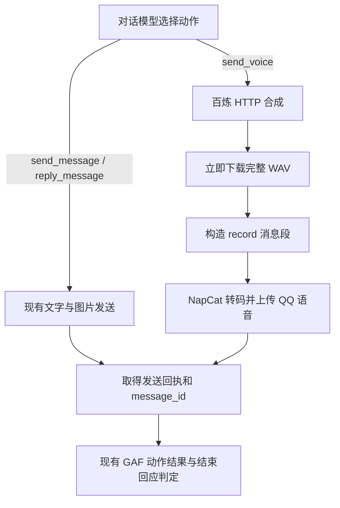

# NapCat 自主群聊语音回复设计

## 1. 目标与范围

在现有 GAF 自主群聊中，让对话模型通过工具选择发送文字或原生 QQ 语音。语音合成使用阿里云百炼 `qwen-audio-3.1-tts-plus` 和用户配置的自定义音色。发送语音继续使用当前群会话、授权、攒批、steer、动作回执和结束回应规则。

推荐增加 `send_voice` 群动作工具，在一次工具调用内完成文本合成与语音发送。TTS HTTP 适配、音频传输与 QQ 动作回执分别由各自模块负责，模型无需接触下载地址、Base64 或 OneBot 请求结构。

本设计针对已经启用 GAF 的 NapCat 群。普通私聊、其他渠道、已有音频文件的独立发送工具、自动转换所有回复和音色管理界面不纳入这次实现。音色创建属于配置准备，运行中的回复只使用已创建的音色 ID。

## 2. 当前代码的缺口

| 路径 | 现有能力 | 本次需要补齐的行为 |
| --- | --- | --- |
| [`nanobot/audio/`](../../nanobot/audio/) | 配置并调用语音转写服务，把音频变成文字。 | 增加独立的文本转语音适配函数；保持 ASR 与 TTS 配置分开。 |
| [`NapcatChannel.send`](../../nanobot/channels/napcat/runtime.py) | 遍历 `OutboundMessage.media`，全部调用 `_build_image_segment`。 | 当前不能通过这个路径发送原生语音。GAF 语音直接通过专用动作接入，不扩大普通附件的含义。 |
| [`GroupRun.send`](../../nanobot/channels/napcat/group_tools.py) | 构造文字、图片、提及和引用，调用 NapCat 并同步取得 `message_id`。 | 增加语音构造路径，复用同一套发送与回执收尾。 |
| [`group_turn_policy`](../../nanobot/channels/napcat/group_tools.py) | 注入当前群的动作工具；普通 `message` 对当前群的发送也转到 QQ 动作。 | 在 TTS 启用时注入 `send_voice`。 |
| [`AgentRunner`](../../nanobot/agent/runner.py) | 同批工具调用中至少一个成功结果请求结束，且全部调用成功时，跳过下一次模型请求。 | 直接复用；语音动作返回现有 `ToolResult`。 |

Telegram 已通过自己的渠道适配器区分 `send_voice` 和 `send_audio`，这能说明 Nanobot 的消息架构容纳语音，但不会自动使 NapCat 获得相同能力。相关 PR 的状态与实际改动见 [上游 PR 与协议调研](napcat-voice-output-research.md)。

## 3. 模型工具接口

建议新增以下群动作，名称与现有 `send_message` 保持一致：

```text
send_voice(text: string, instruction?: string, continue_response: boolean = false)
```

| 参数 | 含义 |
| --- | --- |
| `text` | 本次要说的话，必填；作为百炼 `input.text`。 |
| `instruction` | 可选的发声指令，例如轻快、低声或放慢语速；直接对应百炼的 `input.instruction`，省略时不添加发声指令。 |
| `continue_response` | 默认 `false`，本组动作成功后结束回应；需要根据工具结果继续工作时显式设为 `true`，整组执行完后再调用模型。查询、失败和未知结果继续交回模型处理。 |

工具描述说明“使用配置的音色合成给定文本，并向当前群发送一条原生语音”，音色 ID、供应商、输出格式与目标群从当前配置和群运行状态取得。模型可以调用现有文字工具，也可以调用 `send_voice`，还可以在确有两项内容时分别调用两者；一次语音调用只发送一条语音。

例如，模型决定用语音完成回应时：

```json
{
  "text": "嘿嘿，派蒙一直都在呀！",
  "instruction": "用轻快自然的语气说话",
  "continue_response": false
}
```

语气控制是所选模型已经提供的能力。官方文档明确列出该模型的系统音色、复刻音色和设计音色支持 `instruction`，因此无需另造情绪枚举或语速协议。[非实时语音合成：指令控制](https://help.aliyun.com/zh/model-studio/non-realtime-tts-user-guide)

现有群系统提示词已经要求所有可见回应使用可用的群动作工具，这条规则自然覆盖新增工具。使用方法写在工具定义中，群系统提示词继续保持通用，人格仍由用户的现有设定提供。

## 4. 执行流程



`send_voice` 内部会发生合成请求、音频下载与 NapCat RPC，这些是执行端操作。模型只需要调用一次工具；本组动作全部成功且均未请求续调时，运行时直接结束，省去“读取生成路径后再决定发送”的中间模型请求。

合成和下载使用异步 HTTP，放在工具执行路径中；NapCat WebSocket 接收循环继续处理事件与 RPC 回执。语音合成过程中到达的新群消息沿用现有攒批和 steer 生命周期。

## 5. 百炼合成适配

### 5.1 调用方式

首期选用 HTTP 非流式接口：一次提交完整文本，取得完整音频地址后立即下载到内存。QQ 原生语音需要完整音频再上传，使用 WebSocket 或 SSE 分块不会让群成员提前听到内容，HTTP 非流式更贴合这条执行路径。[非实时合成使用方法](https://help.aliyun.com/zh/model-studio/non-realtime-tts-user-guide)

请求地址为当前地域与业务空间对应的 `/api/v1/services/audio/tts/SpeechSynthesizer`。示意请求如下；字段取自官方接口，凭据通过现有环境变量引用机制提供。[Qwen-Audio-TTS HTTP API](https://help.aliyun.com/zh/model-studio/qwen-audio-tts-http-api)

```json
{
  "model": "qwen-audio-3.1-tts-plus",
  "input": {
    "text": "本次要说的话",
    "voice": "<已创建的自定义音色 ID>",
    "format": "wav",
    "sample_rate": 24000,
    "instruction": "可选的发声指令"
  }
}
```

采用带文件头的 WAV、24 kHz 作为中间音频，交给 NapCat 编码为 QQ 语音，避免先压成 MP3 再编码为 Silk。这里的输出格式由适配器固定，模型只选择文本与发声指令。官方 HTTP 接口支持 WAV 与 24000 Hz；没有 `instruction` 时省略该字段。

读取 `output.audio.url` 后立刻下载；官方链接有效期为 24 小时，工具不把这个短期地址作为后续发送依赖，也不把它交给模型搬运。适配函数返回完整音频字节与本次服务请求 ID，供动作执行与诊断使用；会话只记录文本参数及简短工具结果，音频 Base64 不进入模型上下文。[HTTP 返回体](https://help.aliyun.com/zh/model-studio/qwen-audio-tts-http-api)

### 5.2 配置形状

建议由应用级 `speechSynthesis` 配置拥有合成参数，按现有 `transcription` 的职责划分将生成与识别分开。只适配本次选定的百炼接口，不先增加供应商注册表或自动探测。

```json
{
  "speechSynthesis": {
    "enabled": true,
    "apiBase": "https://<WorkspaceId>.cn-beijing.maas.aliyuncs.com/api/v1",
    "apiKey": "${DASHSCOPE_API_KEY}",
    "model": "qwen-audio-3.1-tts-plus",
    "voice": "<voice_id>"
  }
}
```

`apiBase` 示例使用北京业务空间专属域名；使用新加坡时填写对应的地域域名与同地域 API Key。客户端在这个 API 基础地址后追加 `/services/audio/tts/SpeechSynthesizer`。TTS 配置不改变当前对话模型和语音转写模型。[地域与鉴权要求](https://help.aliyun.com/zh/model-studio/qwen-audio-tts-http-api)

能力默认关闭；开启后配置边界要求 API 基础地址、凭据、模型和音色 ID 完整。工具按启用状态注册，已启用服务的调用错误返回工具结果。配置继续走当前实例的实际配置路径与环境变量解析，避免在多实例部署中读取另一份配置。

用户需要准备业务空间及地域对应的 API 基础地址、该空间的 API Key，以及可用于 `qwen-audio-3.1-tts-plus` 的自定义音色 ID。已有音色直接填写；创建音色时的 `target_model` 必须与合成时的 `model` 一致，否则百炼会拒绝调用。音色创建作为一次配置操作完成，回复路径不会逐次创建或修改音色。[声音复刻 HTTP API](https://help.aliyun.com/zh/model-studio/voice-clone-design-http-api)

## 6. NapCat 原生语音发送

音频字节编码为 `base64://`，构造纯语音消息段：

```json
{
  "type": "record",
  "data": {
    "file": "base64://<WAV 字节的 Base64>"
  }
}
```

通过现有 `send_msg` 发往当前群，沿用当前群的授权与 RPC 关联。Nanobot 和 NapCat 即使分处 Windows、Debian 或容器中，也不需要共享本地文件路径。NapCat 接收文件内容后负责解码、转 Silk、上传和构造 QQ PTT 元素。[NapCat 文件处理](https://napneko.github.io/develop/file)、[PTT 构造源码](https://github.com/NapNeko/NapCatQQ/blob/main/packages/napcat-onebot/api/file.ts)

首期每次发送只包含一个 `record`。需要文字补充时，由模型明确调用另一项文字动作。NapCat 源码可以构造语音与文字、引用混合的数组，但官方没有给出 QQ 客户端呈现保证；把引用和混排作为首期接口会让工具对显示效果作出缺乏依据的承诺。详细证据见 [语音与引用、文字混合](napcat-voice-output-research.md#语音与引用文字混合)。

文本和语音在 `GroupRun` 内共用一个私有发送收尾方法：持有现有 `observer.sending` 状态，提交 `send_msg`，核对回执的 `message_id`，调用 `acknowledged` 并记录 `sent_ids`。`_group_action` 继续更新机器人发出消息 ID。这样语音遵守现有自身消息观察、回执去重和动作统计规则，不新增调度器、outbox 或历史镜像。

音频在合成适配和 NapCat 请求之间以字节传递，正常路径无需在 Nanobot 写临时文件。现有 `restrictToWorkspace` 继续生效；生成与发送流程本身不需要放宽文件访问范围，也不需要为临时音频增加目录白名单。

## 7. 动作结果与失败语义

| 结果 | 对 QQ 的影响 | 工具结果与后续处理 |
| --- | --- | --- |
| 百炼合成或音频下载失败 | 没有提交 QQ 发送。 | 返回合成或下载错误，交回模型决定下一步。 |
| NapCat 明确拒绝，包括音频转码或上传报错 | 发送失败。 | 沿用 `ActionRejectedError` 和失败动作记录。 |
| NapCat 返回有效 `message_id` | 已取得平台发送成功回执；不代表群成员已收听。 | 返回 `status=succeeded`、`message_id`，记录成功动作。 |
| 已提交发送但回执超时、连接断开或缺少消息 ID | 语音可能已经到达 QQ。 | 沿用 `ActionOutcomeUnknownError`，返回未知结果；重复提交可能造成重复语音。 |

成功结果保持简短，例如 `{"status":"succeeded","message_id":"123456"}`。TTS 合成成功和已入队都不等于 QQ 发送成功。

结束判定由 Runner 执行：同一次模型回复中的全部动作都成功，并且均未请求续调时，结束当前回应；任一动作显式传入 `continue_response=true`，或包含查询和通用工具时，执行完整组后再调用模型。任一调用失败或结果未知，也把全部结果交回模型。模型通过 `continue_response` 表达是否需要根据结果继续工作，执行端判断工具是否成功。

执行端不自动重试语音发送或替换为文字。失败时额外发送文字属于新的可见动作，继续由模型选择现有工具决定。生成后的文件地址、Base64 和供应商错误原始响应不作为新的群消息发送。

## 8. 实现落点

| 文件或模块 | 变更职责 |
| --- | --- |
| `nanobot/audio/synthesis_config.py` | 定义本次百炼语音合成的配置契约。 |
| `nanobot/audio/synthesis.py` | 异步调用百炼 HTTP 合成、下载音频，返回音频字节及请求标识；使用当前实例配置。 |
| `nanobot/config/schema.py` | 组装应用级 `speechSynthesis` 配置并沿用环境变量解析。 |
| `nanobot/channels/napcat/group_tools.py` | 新增 `send_voice`，通过窄类型回调取得音频，构造 `record`，复用发送收尾与 `ToolResult`。 |
| `nanobot/channels/napcat/runtime.py` | 将当前实例的语音合成能力绑定到群动作；保持已有 RPC 接收与发送回执路径。 |
| 配置文档 | 说明合成参数、音色 ID、配置路径及原生语音验收方法。 |

WebUI 在“设置 → 功能 → 语音合成”中呈现同一配置，沿用现有设置 API、开关、配置弹窗和自动保存方式。保存后从下一轮群聊处理起生效，无需重启。API 密钥留空时保留已有值或环境变量引用，读取设置时只返回密钥是否已配置；客户端不执行合成与发送。

## 9. 验收行为

实施时先独立确定对应的外部行为，再修改生产代码。沿用现有群工具和结束回应覆盖，只为本次确认的行为修订或增加必要用例：模型选择文字时继续发文字；选择语音时只提交 `record`；语音成功必须包含平台消息 ID；失败或未知结果不得触发成功结束；多工具中任一失败都要返回结果；自身消息回流继续遵守原有规则。

真实验收使用百炼自定义音色生成短句，通过目标部署实例的 NapCat 发往用户明确授权的测试群，检查 QQ 中显示原生语音且能够播放、音色符合所选配置、回执 ID 与动作记录一致。协议和源码只能证明请求路径可构造；真实验收要排除目标 NapCat 构建的音频转码组件与百炼 WAV 不兼容导致的发送失败。

## 10. 主要来源

- [本项目上游 PR 与协议调研](napcat-voice-output-research.md)：PR 状态、实际修改路径及 NapCat 编码/发送流程。
- [百炼非实时语音合成](https://help.aliyun.com/zh/model-studio/non-realtime-tts-user-guide)：支持模型、非流式调用、发声指令与自定义音色。
- [Qwen-Audio-TTS HTTP API](https://help.aliyun.com/zh/model-studio/qwen-audio-tts-http-api)：请求地址、`input`、格式、采样率及音频 URL。
- [声音复刻 HTTP API](https://help.aliyun.com/zh/model-studio/voice-clone-design-http-api)：音色 ID 和 `target_model` 的一致性要求。

百炼本地原文对应文档技能目录下的 `raw/_short/qwen-audio-tts-http-api-6a5232db21a53ba2.md`、`raw/_short/voice-clone-design-http-api-8f39943e5a676aae.md` 与 `raw/model-user-guide/model-experience/speech-synthesis/non-realtime-tts-user-guide.md`；本设计已对照上述官方在线页面核对接口字段。
